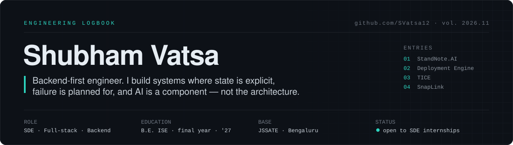
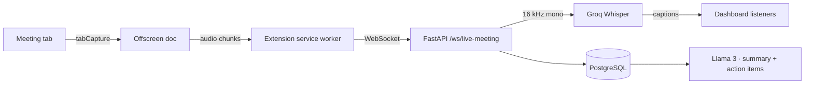
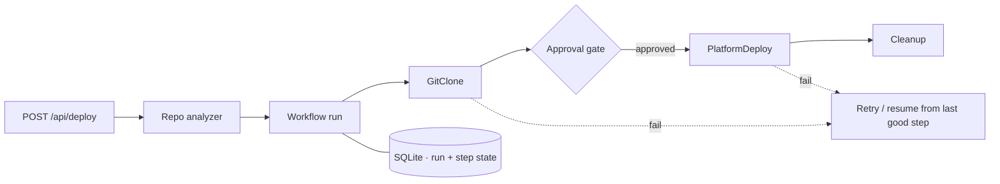

<a href="https://github.com/SVatsa12">
  
</a>

<table>
<tr>
<td width="62%" valign="top">

**What I work on**

APIs, real-time pipelines and the data models behind them, plus the LLM layer on top when it's actually useful.
Most of my projects are FastAPI or Node backends with a React front end, built to keep working when an external API, a network call or a deploy step fails.

Interested in: API and schema design · system design · real-time systems · RAG / LLM applications · DSA

</td>
<td width="38%" valign="top">

**Index**

- **Edu:** B.E. ISE · CGPA 8.96
- **Lang:** Java · Python · JavaScript · SQL
- **Jump:** [Systems](#-01--selected-systems) · [Stack](#-02--stack-by-domain) · [Notes](#-03--engineering-notes)
- **Links:** [Portfolio](https://shubhamvatsa.vercel.app) · [LinkedIn](https://linkedin.com/in/svatsa12) · [LeetCode](https://leetcode.com/u/s_vatsa1972)

</td>
</tr>
</table>

<br/>

## § 01 — Selected Systems

<i>Four entries. Each one says what works today, separate from what's planned.</i>

<br/>

### `01` &nbsp;StandNote.AI

`FastAPI` `WebSockets` `Chrome MV3` `Groq Whisper` `Llama 3` `SQLAlchemy` `PostgreSQL` `React`

> Live transcription and summaries for meetings you're already in. It runs beside Meet, Zoom or Teams in the browser and never hosts the call.

<table>
<tr><td width="150"><b>Problem</b></td><td>Notes from a live call are either incomplete or written after the fact. Meeting tools that do this want you to move your calls onto their platform.</td></tr>
<tr><td><b>Approach</b></td><td>A Chrome extension captures the meeting tab's audio and streams it to a FastAPI backend over a WebSocket. The backend transcribes it, sends live captions to the dashboard, and stores the transcript for summaries and action items.</td></tr>
<tr><td><b>Implementation</b></td><td><code>tabCapture</code> + an offscreen document (MV3 service workers can't record audio) → WebSocket → audio-format detection, then <code>pydub</code> converts it to 16 kHz mono → <code>whisper-large-v3-turbo</code> via Groq. Summaries use <code>llama-3.3-70b</code>; action items use Llama 3 via Ollama. JWT auth, SQLAlchemy models, backend deployed on Render.</td></tr>
<tr><td><b>Works today</b></td><td>Live captions, saved transcripts, AI summaries, action-item extraction, meeting history and a weekly-activity dashboard.<br/><i>Planned: speaker diarization, PDF/Docs export.</i></td></tr>
<tr><td><b>Hard part</b></td><td>Session handling: one <i>recorder</i> socket per session and many <i>listener</i> sockets, with dead listeners removed during each broadcast so one dropped client doesn't stall the stream. Caption latency stayed <b>under 2 s</b> with <b>5+ concurrent audio streams</b>.</td></tr>
</table>

<details>
<summary><sub>architecture</sub></summary>



</details>

<sub>→ [SVatsa12/StandNote](https://github.com/SVatsa12/StandNote)</sub>

<br/>

### `02` &nbsp;Deployment Automation Tool

`FastAPI` `SQLAlchemy` `SQLite` `BackgroundTasks` `React` `Vite`

> A workflow engine that clones a GitHub repo and deploys it, with resume, per-step retries and manual approval gates.

<table>
<tr><td width="150"><b>Problem</b></td><td>Deploy scripts fail halfway and have to start over. Nothing records which step broke, so a person has to rerun everything.</td></tr>
<tr><td><b>Approach</b></td><td>Every deployment is a <i>workflow run</i> made of <i>step runs</i>, and both are stored in the database. The engine executes steps in order and records every state change, so a failed run resumes from its last successful step.</td></tr>
<tr><td><b>Implementation</b></td><td>Explicit state machines for workflows (<code>PENDING → RUNNING → WAITING_APPROVAL → SUCCESS / FAILED / REJECTED</code>) and for steps. Steps: <code>GitClone → PlatformDeploy → Cleanup</code>, each with its own retry budget. A repo analyzer detects project type and framework. Platform deployers sit behind a <code>DeployerFactory</code> interface. Runs go through FastAPI <code>BackgroundTasks</code>, so the API returns a run ID right away.</td></tr>
<tr><td><b>Works today</b></td><td>Workflow engine, resume, retries, approvals, full REST API, run history. End-to-end deploys verified for static sites on Vercel / Netlify.<br/><i>In progress: framework builds; adapters for Railway, Render, Fly and Heroku are scaffolded but not yet verified.</i></td></tr>
<tr><td><b>Hard part</b></td><td>Making retries survive restarts. The retry count lives in the step-run row, not in memory, and the retry loop is iterative rather than recursive. If a clone fails because the branch doesn't exist, it falls back to the repo's default branch.</td></tr>
</table>

<details>
<summary><sub>architecture</sub></summary>



</details>

<sub>→ [SVatsa12/Deployment-Automation-Tool](https://github.com/SVatsa12/Deployment-Automation-Tool)</sub>

<br/>

### `03` &nbsp;TICE — Threat Intelligence Correlation Engine

`FastAPI` `async` `React 19` `Three.js` `MongoDB` `Gemini`

> Enter one IP address and get one risk score, the evidence behind it, and a written attribution report. **Top 5 of ~400 teams at AXIOM Hackathon (SJBIT)**, team lead.

<table>
<tr><td width="150"><b>Problem</b></td><td>To check an IP, an analyst opens several OSINT tools, reads results that disagree, and reconciles them by hand.</td></tr>
<tr><td><b>Approach</b></td><td>A pipeline: source adapters → normalizer and correlator → risk scorer → report generator. Each stage has one job, so a new source only needs a new adapter.</td></tr>
<tr><td><b>Implementation</b></td><td>Async FastAPI calls AbuseIPDB, Shodan and IPInfo. Results are mapped to one schema and correlated into a single threat profile. Gemini writes the report, and a template report takes over if Gemini fails. Analysis history is stored in MongoDB. The SOC-style dashboard has a Three.js globe, evidence tabs and a raw-JSON drawer.</td></tr>
<tr><td><b>Works today</b></td><td>Multi-source lookup, a 0–100 risk score with its rationale, AI reports, Markdown export, and a mock mode that runs without any API keys.</td></tr>
<tr><td><b>Hard part</b></td><td>Scoring when sources are missing. Each source produces a 0–100 subscore, and the weights are re-normalized over the sources that actually responded. A missing key or a timeout changes how confident the score is, not the scale it's on.</td></tr>
</table>

<sub>→ [SVatsa12/IP-Information-Retriever](https://github.com/SVatsa12/IP-Information-Retriever)</sub>

<br/>

### `04` &nbsp;SnapLink

`Node.js` `Express` `Prisma` `PostgreSQL` `JWT` `React` `Docker`

> A URL shortener with accounts, link ownership and click analytics.

<table>
<tr><td width="150"><b>Problem</b></td><td>The redirect path runs on every click, so it has to be fast. Analytics and ownership checks can't slow it down.</td></tr>
<tr><td><b>Approach</b></td><td>Layered Express API (routes → controllers → middleware). Prisma schema designed around two access patterns: redirect lookup and the "my links" dashboard.</td></tr>
<tr><td><b>Implementation</b></td><td>7-character <code>nanoid</code> codes. A unique index on <code>shortCode</code>, plus composite indexes on <code>(shortCode, isActive)</code> for redirects and <code>(userId, createdAt)</code> for dashboard listing. Atomic <code>clickCount</code> increment. bcrypt + JWT auth; ownership is checked before any stats request or delete. Postgres 16 runs via Docker Compose.</td></tr>
<tr><td><b>Works today</b></td><td>Register/login, shorten, redirect, per-link analytics, delete, responsive dashboard.</td></tr>
<tr><td><b>Hard part</b></td><td>Keeping each redirect to one indexed read and one atomic write, so concurrent clicks never lose a count. Lookups stay <b>under 50 ms</b> across <b>1,000+ records</b>.</td></tr>
</table>

<sub>→ [SVatsa12/SnapLink](https://github.com/SVatsa12/SnapLink)</sub>

<br/>

<details>
<summary><b>On the bench</b> <sub>— in progress, not yet public</sub></summary>
<br/>

| | |
|---|---|
| **SmartOrb** | AI browsing companion: Tauri desktop app with a FastAPI backend. |
| **DPDP Compliance Audit Engine** | Final-year team project. NLP engine that audits how organisations handle data against India's DPDP Act and IT Act. Two research papers in progress. |
| **Autonomous Document Reviewer** | RAG pipeline for documents: PDF extraction → cleaning → chunking → clause extraction (rent, security deposit) → rule checks + LLM review. |

</details>

<br/>

## § 02 — Stack by domain

<i>Only tools I've shipped something with. The right-hand column says where.</i>

| Domain | Tools | Used in |
|:--|:--|:--|
| **Languages** | Java · Python · JavaScript · SQL | everything below; Java for DSA and Spring Boot |
| **Backend** | FastAPI · Node.js · Express · REST · WebSockets · Spring Boot | StandNote · Deploy Tool · TICE · SnapLink · SIH |
| **Frontend** | React · Vite · Tailwind CSS · Three.js | all four systems · TICE globe |
| **Data** | PostgreSQL · Prisma · SQLAlchemy · MongoDB · SQLite | SnapLink · StandNote · TICE · Deploy Tool |
| **Applied AI** | LLM APIs (Groq, Gemini) · Whisper · Ollama · RAG | StandNote · TICE · Document Reviewer |
| **Tooling** | Git · GitHub Actions · Docker · Linux · Render · Vercel | deploys and local infra |

<br/>

## § 03 — Engineering notes

<i>Habits these projects taught me. Each one points to the code where it shows up.</i>

```text
01  State belongs in a table, not a variable.     → Deploy Tool: run + step state persisted; resume reads the DB
02  Design the degraded path first.               → TICE: template fallback, mock mode, re-normalized weights
03  The hot path gets the index.                  → SnapLink: composite indexes shaped around redirects
04  One layer, one job.                           → routes → controllers → middleware · adapters → scorer → report
05  AI sits behind a function boundary.           → Groq / Ollama / Gemini are swappable service calls
```

<br/>

## § 04 — Problem solving & record

<table>
<tr>
<td width="50%" valign="top">

**DSA**

**250+** problems on LeetCode: arrays, trees, graphs, dynamic programming.<br/>
<sub>→ [leetcode.com/u/s_vatsa1972](https://leetcode.com/u/s_vatsa1972)</sub>

</td>
<td width="50%" valign="top">

**Hackathons**

**AXIOM, SJBIT:** top 5 of ~400 teams (team lead, TICE)<br/>
**Smart India Hackathon:** college-level selection (team lead). Spring Boot service mapping NAMASTE ↔ ICD-11 codes for EMR interoperability.

</td>
</tr>
</table>

<br/>

---

`end of log` &nbsp;·&nbsp; [Portfolio](https://shubhamvatsa.vercel.app) &nbsp;·&nbsp; [LinkedIn](https://linkedin.com/in/svatsa12) &nbsp;·&nbsp; [LeetCode](https://leetcode.com/u/s_vatsa1972) &nbsp;·&nbsp; [qshubhamq2@gmail.com](mailto:qshubhamq2@gmail.com) &nbsp;·&nbsp; open to SDE / backend / full-stack internships
