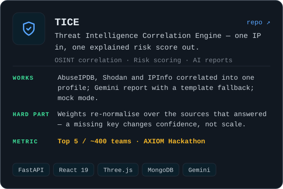

<!-- Generated by scripts/build_profile.py. Edit the script, not this file. -->

  

  

  
  

  
  

  
  

  
  

  

  <a href="https://github.com/SVatsa12">GitHub</a> &nbsp;·&nbsp; <a href="https://linkedin.com/in/svatsa12">LinkedIn</a> &nbsp;·&nbsp; <a href="https://leetcode.com/u/s_vatsa1972">LeetCode</a> &nbsp;·&nbsp; <a href="https://shubhamvatsa.vercel.app">Portfolio</a>

activity log · plain text

- [migrating database and improving ui](https://github.com/SVatsa12/SnapLink/commit/a6349a77cbbe96aac96f777a9c096baeaea18be0) · `SnapLink` · 8h ago
- [Log auth errors to console](https://github.com/SVatsa12/SnapLink/commit/955c9304cefd859e15dedb8aa01e4fc485f501c3) · `SnapLink` · 9h ago
- [feat: split-screen sign-in page on desktop](https://github.com/SVatsa12/carepal-support/commit/1f3919b3d3ab26ffd3100c2a05156ae28dff4445) · `carepal-support` · 19h ago
- [docs: README](https://github.com/SVatsa12/carepal-support/commit/ee45bbbef5fb8b6b3de29134e289577025fb0bd5) · `carepal-support` · 19h ago
- [feat: link footer admin button to login page and update demo credentials](https://github.com/SVatsa12/tactyqal-labs/commit/88335a9d467fae3fa4e43cee70095179765141ad) · `tactyqal-labs` · 1d ago

  

