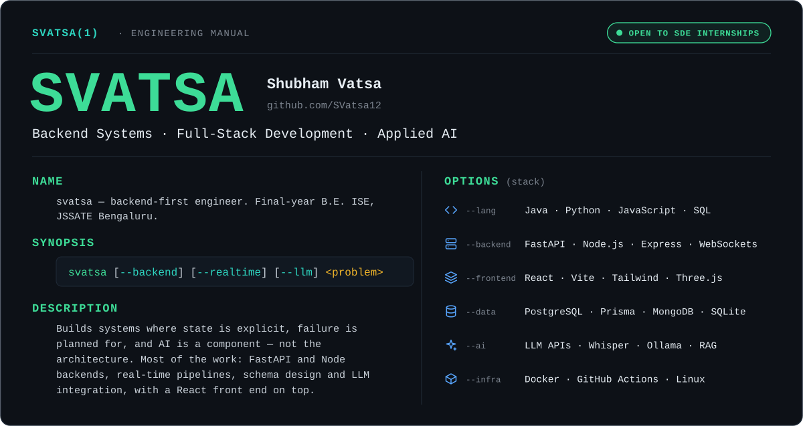
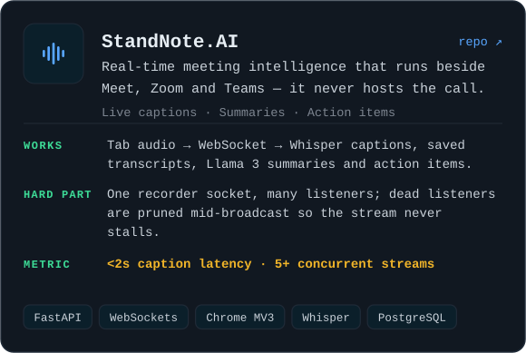
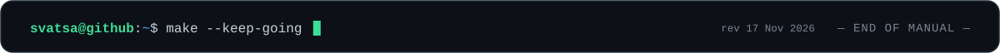

<!-- Generated by scripts/build_profile.py. Edit the script, not this file. -->

  

  

  
  

  
  

  
  

  
  

  

  <a href="https://github.com/SVatsa12">GitHub</a> &nbsp;·&nbsp; <a href="https://linkedin.com/in/svatsa12">LinkedIn</a> &nbsp;·&nbsp; <a href="https://leetcode.com/u/s_vatsa1972">LeetCode</a> &nbsp;·&nbsp; <a href="https://shubhamvatsa.vercel.app">Portfolio</a>

activity log · plain text

- [feat: link footer admin button to login page and update demo credentials](https://github.com/SVatsa12/tactyqal-labs/commit/88335a9d467fae3fa4e43cee70095179765141ad) · `tactyqal-labs` · 5h ago
- [fix(web): make navbar Blog link smooth scroll to #blog section](https://github.com/SVatsa12/tactyqal-labs/commit/73cfe1b9d6aa8e77109914c5cd3da2250a71f024) · `tactyqal-labs` · 6h ago
- [Gate v2, health endpoint and real demo clauses for /api/predict](https://github.com/SVatsa12/Major-Project/commit/c735582b90be3828f80ddd003c79a02bbf8f57d6) · `Major-Project` · 1d ago
- [Serve /api/predict with the deployed context classifier](https://github.com/SVatsa12/Major-Project/commit/e7f8b31c6e9883e58dc180e350cf6ae0d42a2de9) · `Major-Project` · 1d ago

  

