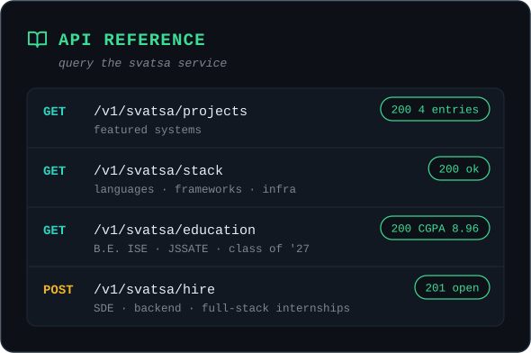
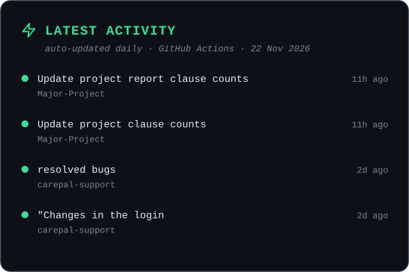
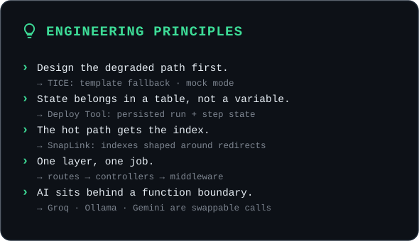

<!-- Generated by scripts/build_profile.py. Edit the script, not this file. -->

  

  

  
  

  
  

  
  

  
  

  

  [GitHub](https://github.com/SVatsa12) &nbsp;·&nbsp; [LinkedIn](https://linkedin.com/in/svatsa12) &nbsp;·&nbsp; [LeetCode](https://leetcode.com/u/s_vatsa1972) &nbsp;·&nbsp; [Portfolio](https://shubhamvatsa.vercel.app)

activity log · plain text

- [feat: implement Groq-powered transcript summarization service and remove shortcut file](https://github.com/SVatsa12/StandNote/commit/5a4721b0b8908dedc3462dc4b80260a82649fe8e) · `StandNote` · 5mo ago
- [Add Privacy Policy for Edge Store](https://github.com/SVatsa12/StandNote/commit/ecdffbfbe2fd01f1c7aae4bbb91124ea0f68c588) · `StandNote` · 5mo ago
- [Add gitignore and remove node_modules](https://github.com/SVatsa12/SnapLink/commit/25eafe83dc4842d9e3b9f7fb593497d01540a782) · `SnapLink` · 6mo ago
- [Refine short URL handling in frontend and backend. Update App component to improve user experience with URL display, enhance redirect functionality in FastAPI, and adjust Vite config for better route management.](https://github.com/SVatsa12/Deployment-Automation-Tool/commit/debfc45ebf7ccb27ae68ffa351287dbb5cb993c8) · `Deployment-Automation-Tool` · 7mo ago
- [Enhance deployment URL handling in frontend and backend. Update App component to prioritize short URLs, add a hint for long URLs, and implement a redirect endpoint for short links in FastAPI. Modify Vite config to support new short link routes.](https://github.com/SVatsa12/Deployment-Automation-Tool/commit/a7726fa8f5fa1f9a2ae3ac275176a79bcaddb2b5) · `Deployment-Automation-Tool` · 7mo ago

  

