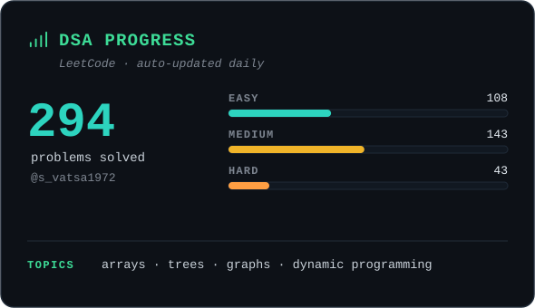

<!-- Generated by scripts/build_profile.py. Edit the script, not this file. -->

  

  

  
  

  
  

  
  

  
  

  

  [GitHub](https://github.com/SVatsa12) &nbsp;·&nbsp; [LinkedIn](https://linkedin.com/in/svatsa12) &nbsp;·&nbsp; [LeetCode](https://leetcode.com/u/s_vatsa1972) &nbsp;·&nbsp; [Portfolio](https://shubhamvatsa.vercel.app)

activity log · plain text

- [feat(outbox): single active relay via a Postgres advisory-lock leader](https://github.com/SVatsa12/Milestone-escrow-ledger/commit/2c029071f1d627a5f1c4f6f0ca3d37ff0f8a1ed2) · `Milestone-escrow-ledger` · 1h ago
- [test: one outbox relay per test JVM (CI reordered an aggregate&#x27;s events)](https://github.com/SVatsa12/Milestone-escrow-ledger/commit/f61408cae8c62916e35309b7e6fe51644489a6a0) · `Milestone-escrow-ledger` · 1h ago
- [Remove backend API link from README](https://github.com/SVatsa12/AI-Project-Manager/commit/050dd1ea6388528d549a372efe974f81179e03de) · `AI-Project-Manager` · 2w ago
- [fix: update decommissioned groq model to llama-3.3-70b-versatile](https://github.com/SVatsa12/AI-Project-Manager/commit/080b48087b196f15c111cd3bcb23e221d9771634) · `AI-Project-Manager` · 5mo ago

  

