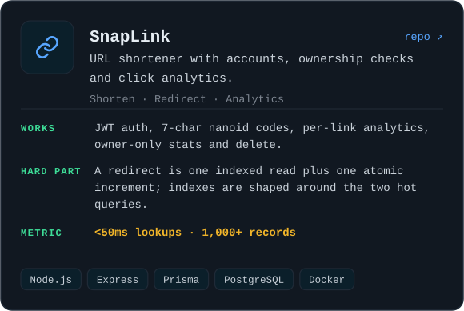
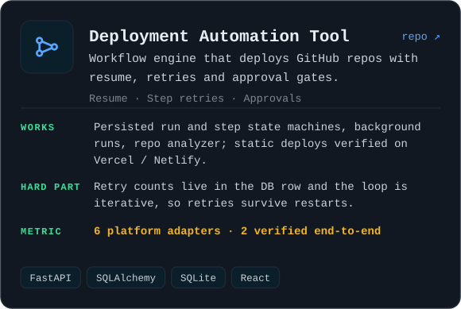
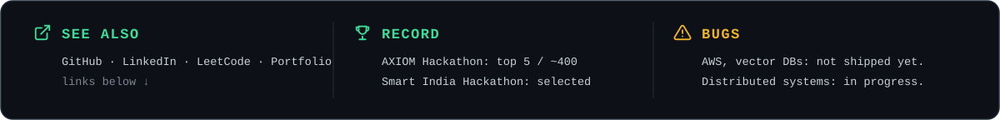

<!-- Generated by scripts/build_profile.py. Edit the script, not this file. -->

  

  

  
  

  
  

  
  

  
  

  

  <a href="https://github.com/SVatsa12">GitHub</a> &nbsp;·&nbsp; <a href="https://linkedin.com/in/svatsa12">LinkedIn</a> &nbsp;·&nbsp; <a href="https://leetcode.com/u/s_vatsa1972">LeetCode</a> &nbsp;·&nbsp; <a href="https://shubhamvatsa.vercel.app">Portfolio</a>

activity log · plain text

- [docs(chaos): evidence from a full run on JDK 21 with the #54 checks and the #55 fix](https://github.com/SVatsa12/Milestone-escrow-ledger/commit/2552fbcda5c0ca1b7d047625aeb6b89059da051b) · `Milestone-escrow-ledger` · 8h ago
- [test(arch): scan main sources for synchronized blocks too](https://github.com/SVatsa12/Milestone-escrow-ledger/commit/0179acaf2fe164411e224749655456f0e3880e1a) · `Milestone-escrow-ledger` · 8h ago
- [Remove backend API link from README](https://github.com/SVatsa12/AI-Project-Manager/commit/050dd1ea6388528d549a372efe974f81179e03de) · `AI-Project-Manager` · 2w ago
- [fix: update decommissioned groq model to llama-3.3-70b-versatile](https://github.com/SVatsa12/AI-Project-Manager/commit/080b48087b196f15c111cd3bcb23e221d9771634) · `AI-Project-Manager` · 5mo ago

  

